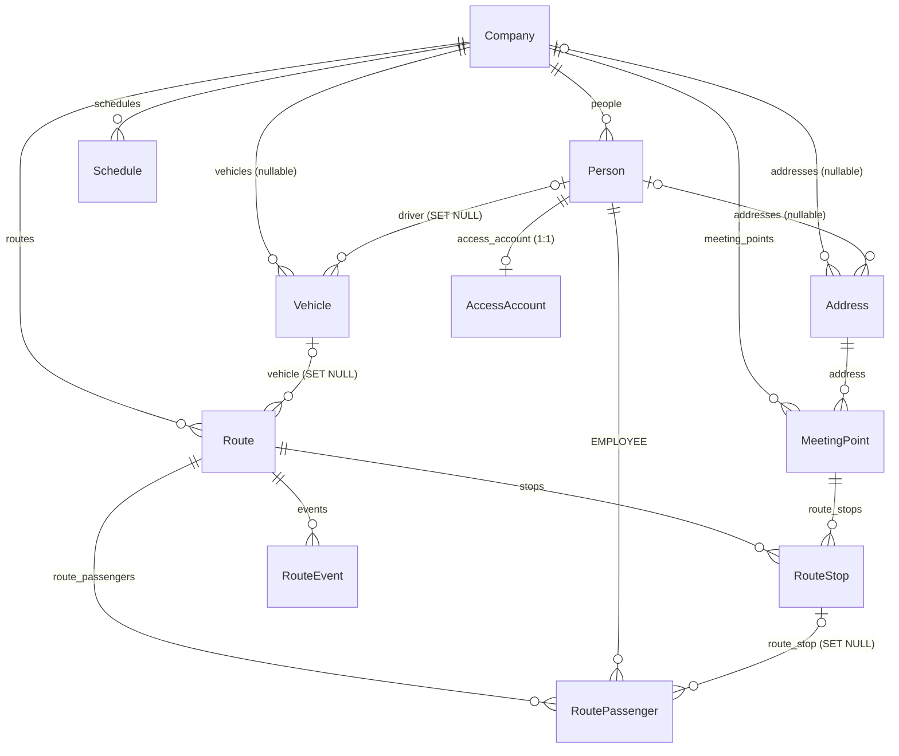

# Banco de dados — Mapa (estado atual)

Fonte: `core/models.py` e migrações `0001`–`0005`. Motor alvo: **PostgreSQL** (o SQLite só existe como fallback local). O mapa foi feito por leitura; não foi possível rodar `makemigrations --check` nem `sqlmigrate` neste ambiente, então o DDL abaixo é o que o Django gera para Postgres pelas regras do ORM, e a seção 6 traz as consultas para conferi-lo no banco real.

## 1. Visão geral

| Item | Valor |
|------|-------|
| App | `core` (todas as tabelas do domínio começam com `core_`) |
| Tabelas do domínio | 11 |
| Tabelas do framework Django | 10 (`auth_*`, `django_admin_log`, `django_content_type`, `django_migrations`, `django_session`) |
| Chaves estrangeiras | 17 |
| Migrações | `0001_initial` … `0005_driver_route_stops` (linear, sem ramificações) |
| Chave primária | `bigint` identidade em todas as tabelas (não é UUID, apesar dos READMEs) |
| Fuso | `USE_TZ=True`: colunas `timestamptz`, gravadas em UTC |
| Extensões necessárias | nenhuma |

`drf_spectacular`, `corsheaders` e `django_filters` não criam tabelas. `simplejwt` **não** usa blacklist (não há tabelas de token): os tokens não ficam no banco.

## 2. Diagrama de relacionamentos

Leitura do domínio: **Company** é a raiz. **Person** (motorista ou funcionário) guarda a identidade; **AccessAccount** é a credencial. **Route** liga-se a um **Vehicle** (e o motorista é `vehicle.driver`); as paradas são **RouteStop** que apontam para **MeetingPoint** (que aponta para um **Address** com latitude/longitude); **RoutePassenger** liga funcionários a rotas; **RouteEvent** registra a operação. **Schedule** pertence à empresa e **não** tem vínculo com rota (ver 5.3).

## 3. Colunas comuns (todas as tabelas `core_*`)

| Coluna | Tipo PostgreSQL | Observação |
|--------|-----------------|------------|
| `id` | `bigint` identidade, PK | |
| `created_at` | `timestamptz` NOT NULL | default aplicado pelo Django |
| `updated_at` | `timestamptz` NOT NULL | atualizado pelo Django (`auto_now`) |
| `is_active` | `boolean` NOT NULL | |

> O Django **não cria DEFAULT no banco**: o valor padrão vive no Python. Qualquer `INSERT` feito por SQL puro (seed, importação, DBA) precisa informar `created_at`, `updated_at` e `is_active`.

## 4. Tabelas

### core_company
| Coluna | Tipo | Regras |
|--------|------|--------|
| `name` | varchar(255) NOT NULL | |
| `email_domain` | varchar(255) NOT NULL | vazio = derivar do nome (0003) |

### core_person
| Coluna | Tipo | Regras |
|--------|------|--------|
| `company_id` | bigint NOT NULL | FK → core_company |
| `name` | varchar(255) NOT NULL | |
| `phone` | varchar(30) NOT NULL | sem normalização |
| `type` | varchar(20) NOT NULL | `DRIVER` \| `EMPLOYEE` (validado só na aplicação; sem CHECK) |
| `license_number` | varchar(100) NULL | obrigatório para DRIVER (só na aplicação) |
| `employee_code` | varchar(100) NULL | obrigatório para EMPLOYEE (só na aplicação) |

Índices: `company_id`, `type` (+ índice `_like` gerado pelo Django para varchar).

### core_accessaccount
| Coluna | Tipo | Regras |
|--------|------|--------|
| `person_id` | bigint NOT NULL | FK 1:1 → core_person, UNIQUE |
| `email` | varchar(254) NOT NULL | UNIQUE global |
| `password_hash` | varchar(255) NOT NULL | hash Django (PBKDF2) |
| `must_change_password` | boolean NOT NULL | |
| `failed_login_attempts` | integer NOT NULL | |
| `last_login`, `blocked_until` | timestamptz NULL | |
| `password_reset_code_hash` | varchar(255) NOT NULL | vazio quando não há OTP |
| `password_reset_expires_at`, `password_reset_requested_at` | timestamptz NULL | |
| `password_reset_code_used` | boolean NOT NULL | |
| `role` | varchar(20) NOT NULL, indexado | `DRIVER` \| `EMPLOYEE` \| `MANAGER` (0006, posterior a este mapeamento inicial; default `EMPLOYEE`, backfill por `person.type`) |

Contém dados sensíveis: hashes de senha e de OTP.

**Atualização (0006_access_account_role, adicionada após o mapeamento inicial):** `AccessAccount` ganhou `role`, com o perfil `MANAGER` — a "conta de gestor" que faltava é isto, não o superusuário do admin (ver `03-migrations-e-superuser.md`, seção 2). `core/permissions.py` passou a ter `IsManager`/`IsDriver`/`IsManagerOrDriver`, e `DEFAULT_PERMISSION_CLASSES` no `settings.py` não é mais `AllowAny` — a API já exige autenticação por padrão (o achado S-01 do backlog está, na prática, resolvido; `10-lacunas-e-melhorias.md` ainda não foi reauditado linha a linha contra essa mudança).

### core_address
`company_id` bigint NULL (FK), `person_id` bigint NULL (FK), `street` varchar(100), `number` varchar(20), `city` varchar(50), `state` varchar(50), `zip_code` varchar(10), `latitude` numeric(9,6), `longitude` numeric(9,6) — todos NOT NULL exceto as FKs. Sem CHECK garantindo que ao menos uma FK esteja preenchida.

### core_meetingpoint
`company_id` bigint NOT NULL (FK), `address_id` bigint NOT NULL (FK), `name` varchar(255) NOT NULL.

### core_vehicle
`company_id` bigint NULL (FK), `driver_id` bigint NULL (FK → core_person, SET NULL), `plate_number` varchar(20) NOT NULL **UNIQUE**, `model` varchar(100), `capacity` integer NOT NULL CHECK (≥ 0).

### core_route
`company_id` bigint NOT NULL (FK), `vehicle_id` bigint NULL (FK → core_vehicle, SET NULL, 0005), `name` varchar(255) NOT NULL.

### core_routestop (0005)
`route_id` bigint NOT NULL (FK), `meeting_point_id` bigint NOT NULL (FK), `sequence` smallint NOT NULL CHECK (≥ 0).
Constraint: `core_routestop_unique_route_sequence` UNIQUE (`route_id`, `sequence`).

### core_schedule
`company_id` bigint NOT NULL (FK), `weekdays` **jsonb** NOT NULL (lista de dias), `time` time NOT NULL.

### core_routepassenger
`person_id` bigint NOT NULL (FK), `route_id` bigint NOT NULL (FK), `route_stop_id` bigint NULL (FK → core_routestop, SET NULL), `boarding_status` varchar(20) NOT NULL (`pending`\|`confirmed`\|`absent`, 0005).
Constraints: UNIQUE (`person_id`, `route_id`); índice explícito `core_routep_person__3af0b2_idx` em (`person_id`, `route_id`).

### core_routeevent
`route_id` bigint NOT NULL (FK), `event_type` varchar(20) NOT NULL (`departure`\|`arrival`\|`stop`\|`delay`\|`incident`), `description` text NOT NULL, `latitude`/`longitude` numeric(9,6) NOT NULL, `timestamp` timestamptz NOT NULL (`auto_now_add`).
É a única tabela que cresce sem parar.

### Tabelas do framework (criadas por `migrate`)
`django_migrations` (histórico), `django_content_type`, `auth_permission`, `auth_group`, `auth_group_permissions`, `auth_user`, `auth_user_groups`, `auth_user_user_permissions`, `django_admin_log`, `django_session`.
**`auth_user` é onde o superusuário do admin será criado** — separado de `core_accessaccount` (ver `03-migrations-e-superuser.md`).

## 5. Integridade: o que o banco garante e o que não garante

### 5.1 Exclusão em cascata (ORM, não banco)
O `on_delete` do Django é executado **pela aplicação**; as FKs do banco não têm `ON DELETE` (comportamento `NO ACTION`, com verificação adiada até o commit). Consequência: um `DELETE` por SQL puro falha com violação de FK; um `DELETE` pela API/ORM apaga em cascata.

| Ao apagar… | O ORM apaga também |
|-----------|--------------------|
| Company | Person, Vehicle, Route, Schedule, MeetingPoint, Address (e, por eles, AccessAccount, RouteStop, RoutePassenger, RouteEvent) |
| Person | AccessAccount, Address, RoutePassenger; `Vehicle.driver` vira NULL |
| Vehicle | `Route.vehicle` vira NULL |
| Route | RouteStop, RoutePassenger, RouteEvent |
| RouteStop | `RoutePassenger.route_stop` vira NULL |
| Address | MeetingPoint (e, por ele, RouteStop) |

### 5.2 Regras só na aplicação (sem constraint no banco)
| Regra | Onde vive | Risco |
|-------|-----------|-------|
| DRIVER exige `license_number`; EMPLOYEE exige `employee_code` | `Person.clean()` | Insert por SQL ou `bulk_create` ignora |
| `type` ∈ {DRIVER, EMPLOYEE}; `event_type`, `boarding_status` válidos | choices do Django | Sem CHECK, o banco aceita qualquer texto |
| Vehicle.driver é DRIVER; RoutePassenger.person é EMPLOYEE | serializers | Idem |
| Ponto de encontro da parada é da mesma empresa da rota | `RouteStop.clean()` | Idem |
| Latitude ∈ [-90, 90], longitude ∈ [-180, 180] | `RouteEventSerializer` | `numeric(9,6)` aceita até ±999,999999 |

### 5.3 Lacunas de modelagem
- `employee_code` e `license_number` **não são únicos** (nem por empresa), mas geram o e-mail de login (`core_accessaccount.email`, único global): colisões silenciosas (ver `11-code-review-backend.md`, A5).
- Nada impede inconsistência entre empresas: `Route.vehicle`, `Vehicle.driver`, `RoutePassenger.person` e `MeetingPoint.address` podem pertencer a **outra** empresa.
- `Schedule` pertence à empresa e não à rota: não há como dizer qual horário vale para qual rota.
- `Address` aceita `company` e `person` ambos nulos; o destino da navegação é inferido como "primeiro endereço da empresa sem pessoa e fora das paradas".
- `RoutePassenger` guarda `is_active` além da própria existência do vínculo (dois modos de "remover").

## 6. Índices e redundâncias

Gerados automaticamente: um índice B-tree por FK (16) + um UNIQUE para a 1:1 `accessaccount.person_id`; UNIQUE em `vehicle.plate_number` e `accessaccount.email`; índices `_like` (varchar_pattern_ops) para `type`, `boarding_status`, `plate_number`, `email`.

Redundâncias e lacunas:

| Item | Observação | Ação |
|------|-----------|------|
| `core_routepassenger`: UNIQUE(person, route) **e** Index(person, route) | O índice explícito duplica o índice do UNIQUE; o índice de FK em `person_id` também é coberto | Remover o `Index` em uma migração futura |
| `person.type` (2 valores) | Seletividade baixa | Só útil combinado (`company_id`, `type`) |
| `routeevent` ordenado por `-timestamp` por rota | Sem índice composto | Criar (`route_id`, `timestamp` DESC) |
| Buscas `icontains` (`name`, `plate_number`, `model`) | Viram `ILIKE '%…%'`, sem índice | Irrelevante no volume atual; `pg_trgm` só se crescer |

## 7. Volumetria (estimativa, premissas a validar)

Domínio pequeno: dezenas de empresas, centenas de pessoas e rotas. `core_routeevent` domina o crescimento: com ~50 rotas × ~10 eventos/dia ≈ 180 mil linhas/ano (~40 MB/ano com índices). Um disco de 20 GB e uma instância mínima bastam por anos; o gargalo é o **número de conexões**, não o espaço.

## 8. Como conferir este mapa no banco real

O arquivo `sql/02_verificacao.sql` lista tabelas, colunas, FKs, índices, migrações aplicadas e o superusuário. Rode-o depois do primeiro `migrate` e compare com este documento (esperado: 21 tabelas, 17 FKs no domínio).
